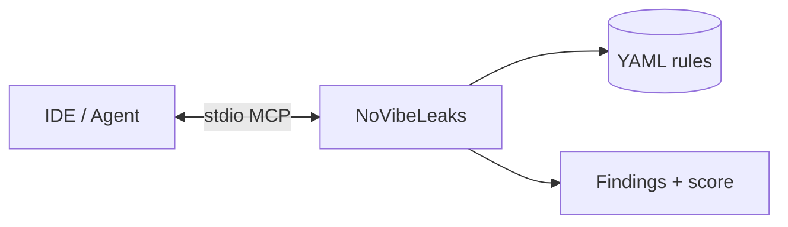

<p align="center">
  
</p>

<h1 align="center">NoVibeLeaks</h1>

<p align="center">
  <strong>Security MCP for vibe-coded apps.</strong><br/>
  Catch secrets and anti-patterns in the agent loop — before they ship.
</p>

<p align="center">
  <a href="https://github.com/Procoder1234556/NoVibeLeaks/actions/workflows/ci.yml"></a>
  <a href="https://pypi.org/project/novibeleaks/"></a>
  <a href="https://modelcontextprotocol.io"></a>
  <a href="LICENSE"></a>
</p>

<p align="center">
  Registry: <code>io.github.Procoder1234556/novibeleaks</code>
</p>

<!-- mcp-name: io.github.Procoder1234556/novibeleaks -->

---

<p align="center">
  
</p>

## What it does

NoVibeLeaks is a **Model Context Protocol** server (Python, stdio). Your coding agent calls five tools while it writes code — same idea as a focused package in [Ponytail’s `ponytail-mcp`](https://github.com/DietrichGebert/ponytail/tree/main/ponytail-mcp), but for **secrets, MCP config risk, and LLM anti-patterns**.

| Tool | Purpose |
|------|---------|
| `check_secrets` | Hardcoded API keys, tokens, private keys |
| `validate_api_key` | Optional live provider check (masked) |
| `scan_vibe_bugs` | Debug flags, CORS, auth gaps, risky patterns |
| `get_security_score` | 0–100 score + category breakdown |
| `list_available_rules` | Loaded YAML rule catalog |



## Install

**PyPI / uvx** (recommended after publish):

```json
{
  "mcpServers": {
    "novibeleaks": {
      "command": "uvx",
      "args": ["novibeleaks"]
    }
  }
}
```

**From this repo** (development):

```bash
cd secmcp
uv sync
uv run mcp dev server.py
```

Copy [`.cursor/mcp.json.example`](.cursor/mcp.json.example) for local paths.

## Repo layout (MCP only)

```
NoVibeLeaks/
├── README.md
├── server.json          # MCP Registry manifest
├── secmcp/              # Python package + server.py + rules/
├── assets/              # README diagrams
└── .github/workflows/   # test + PyPI publish
```

## Registry & marketplace

| Goal | Doc |
|------|-----|
| Official MCP Registry | [docs/MCP_REGISTRY.md](docs/MCP_REGISTRY.md) |
| MCPmarket listing | [docs/MCPMARKET.md](docs/MCPMARKET.md) |

## Develop

```bash
cd secmcp && uv sync && pytest -q
```

## License

MIT — [LICENSE](LICENSE)
