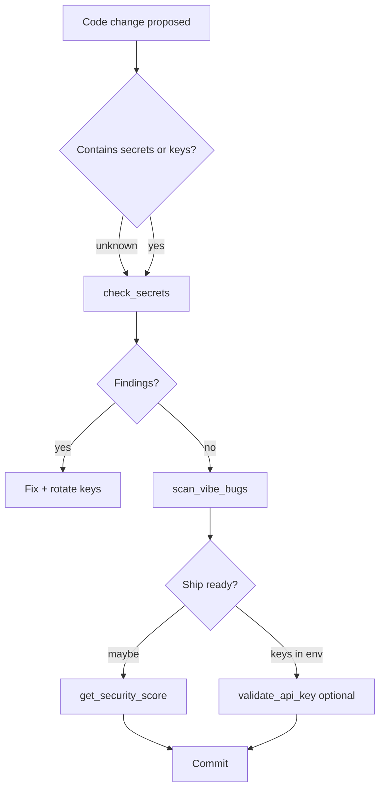

# Application Flow Documentation — SecMCP

Maps how **developers**, **agents**, and **CI** interact with SecMCP across Phase 1–3.

## 1. Entry Points

### Primary

| Entry | User | First experience |
|-------|------|------------------|
| MCP stdio | Agent in Cursor / Claude Code | Tools list includes `check_secrets` |
| `uv run mcp dev server.py` | Human dev | MCP Inspector |
| `prompts-directory-main/README.md` | Human | Docs + skills setup |

### Secondary (future)

| Entry | Phase |
|-------|-------|
| GitHub Action cron | 2 |
| Web upload URL | 3 |
| `npx skills find security mcp` | Discovery → install SecMCP |

---

## 2. Core User Flows

### Flow 1: Agent scans snippet while coding (Phase 1)

**Goal:** Catch secret before save/commit  
**Entry:** User asks agent to implement feature with API key  
**Frequency:** Many times per session  

#### Happy Path

1. User pastes or generates code with `sk-…` in source.
2. Agent calls `check_secrets(code="...")`.
3. Tool returns **critical** finding + line/column + recommendation.
4. Agent refactors to `process.env.OPENAI_API_KEY` and suggests rotation.
5. Agent optionally calls `get_security_score(code="...")` for summary.

#### Error States

| Condition | Tool behavior | Agent action |
|-----------|---------------|--------------|
| No `code` or `path` | ToolError | Ask user for snippet or path |
| Invalid path | ToolError | Verify path |
| Invalid YAML rules | `rules_load_warnings` in response | Fix rules file; restart server |

---

### Flow 2: Validate API key before deploy (Phase 1)

**Goal:** Know if key is dead before production  
**Entry:** User provides key in env setup  

1. Agent calls `validate_api_key(provider="openai", key="...")` **or** extracts from code.
2. Response: `status` + `masked_key` + message (never full key).
3. If `rate_limited`, retry later; do not hammer provider.
4. If `invalid`, user rotates key in provider console.

**Supabase branch:** pass `supabase_url`.  
**AWS branch:** pass access key id as `key`, `aws_secret` separately.

---

### Flow 3: Install SecMCP + skills + Context7 (Phase 1)

**Goal:** &lt; 3 min to first tool call  

1. Clone repo; `cd secmcp`; install deps (see TECH_STACK.md).
2. Enable **Context7 MCP** in IDE (CONTEXT7_MCP.md) — required before any AGENT_PROMPTS task.
3. Optional: `npx skills add vercel-labs/skills@find-skills -g -y` (SKILLS_SETUP.md).
4. Add SecMCP MCP config (README); audit with MCP_SECURITY_CHECKLIST.
5. `mcp dev server.py` → verify 5 tools.
6. Agent: Context7 `query-docs` for `/modelcontextprotocol/python-sdk` → then `list_available_rules`.

---

### Flow 4: Daily repo scan (Phase 2 — planned)

**Goal:** Issues filed without human running scanner  

1. Cron triggers `secmcp.yml`.
2. Workflow runs Python scanner on repo tree.
3. Findings aggregated; GitHub Issue opened or comment on existing.
4. Developer fixes; next run clean or delta comment.

---

### Flow 5: Dashboard scan (Phase 3 — planned)

**Goal:** Non-agent stakeholder sees score  

1. User signs in (Supabase Auth).
2. Upload zip OR connect GitHub OAuth read-only.
3. API runs shared scanner; stores **scores + finding counts** (not raw secrets).
4. History list shows trend; drill-down per dimension.

---

## 3. Navigation Map (Phase 3 UI)

```
Landing
├── Docs (link to GitHub prompts-directory)
├── Sign in
└── Dashboard
    ├── New scan (upload | repo)
    ├── Scan result (score breakdown)
    └── History
```

Phase 1–2: **no web UI**; MCP + CLI/Action only.

---

## 4. Agent ↔ Tool decision map



---

## 5. Exit Points

| Flow | Success | Abandon |
|------|---------|---------|
| Snippet scan | Clean score / fixes applied | User ignores findings (out of product control) |
| MCP install | Tools visible in IDE | Misconfigured path → ToolError loop |
| CI scan | Issue closed | False positive → rule tweak YAML |
