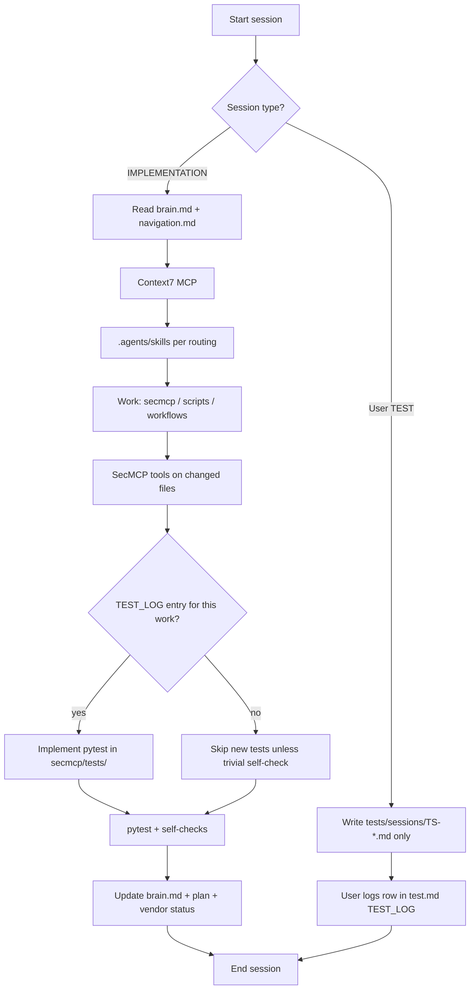

# Taskflow — sessions, leftovers, doc updates

Every **implementation** prompt run follows this flow. **Test-design** sessions are user-led (see [test.md](./test.md)).

## Session types

| Type | Who | Allowed edits | Forbidden |
|------|-----|---------------|-----------|
| **T1 — User test** | Human | `tests/sessions/TS-*.md`, `test.md` TEST_LOG | `secmcp/**` impl, “fixing” prod code |
| **T2 — Implementation** | Agent | `secmcp/`, `scripts/`, `.github/`, docs | Changing user session files without explicit user merge |
| **T3 — Docs-only** | Agent | `prompts-directory-main/**` | Code unless doc drift requires one-line fix |
| **T4 — Parity / vendor** | Agent | `secmcp/` + `examples/` | Editing `vendor/*` except `git pull` |
| **Mode A — Autonomous loop** | Agent | `secmcp/`, `scripts/`, docs per `AGENTS.md` | L6 web unless user asks; T1 waived for brain L* only |

## Mandatory reads (implementation)

1. [brain.md](./brain.md) — leftovers  
2. [navigation.md](./navigation.md) — paths  
3. [test.md](./test.md) — any open TEST_LOG `impl_status: pending`  
4. [AGENT_SKILL_ROUTING.md](./AGENT_SKILL_ROUTING.md)  
5. Phase doc: [IMPLEMENTATION_PLAN.md](./IMPLEMENTATION_PLAN.md) + [VENDOR_STATUS.md](./VENDOR_STATUS.md)

## Mandatory updates (after implementation)

| Doc | Update when |
|-----|-------------|
| **brain.md** | Every impl session — leftover table + recent touched |
| **test.md** | Mark TEST_LOG `impl_status: done` + pytest path |
| **IMPLEMENTATION_PLAN.md** | Checkbox completed |
| **VENDOR_STATUS.md** | Vendor port or parity change |
| **taskflow.md** | Only if process itself changes |
| **navigation.md** | New top-level dirs or glossary terms |
| **AGENT_PROMPTS.md** | New prompt template |

## Leftover discovery (agents)

1. `brain.md` → L* table  
2. `rg "\[ \]" prompts-directory-main/IMPLEMENTATION_PLAN.md`  
3. `VENDOR_STATUS.md` → “What to build next”  
4. Do **not** start L6 (Phase 3 web) while L3 open unless user says so.

## Prompt setup guardrails

When adding/editing a prompt in [AGENT_PROMPTS.md](./AGENT_PROMPTS.md):

- [ ] Context7 line present  
- [ ] Agent-skills prefix present  
- [ ] Points to brain + test protocol if impl  
- [ ] Names files that may change  
- [ ] Says update brain.md on exit  

## Pair with AGENT_PROMPTS

| Prompt | Session type | TEST_LOG required? |
|--------|--------------|-------------------|
| A, E, J | T2 | Yes if new behavior |
| C, H, K | T2/T3 | K → parity only |
| G | T2 | Yes (new rule) |
| User custom | T1 then T2 | **Always** for features |
